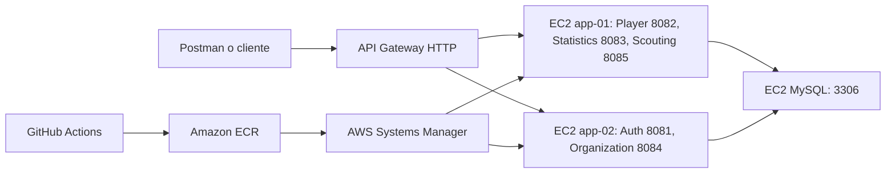

# BooyhaRadar

BooyhaRadar es una aplicación académica compuesta por cinco microservicios Spring Boot. La API Gateway HTTP de AWS recibe las solicitudes y las deriva al servicio correspondiente. MySQL se ejecuta en una EC2 separada.

## Arquitectura



**URL actual de API Gateway:** `https://opmr58gxu5.execute-api.us-east-1.amazonaws.com`

| Servicio | Puerto | Rutas principales |
|---|---:|---|
| Auth | 8081 | `/auth/register`, `/auth/login`, `/usuarios` |
| Player | 8082 | `/jugadores` |
| Statistics | 8083 | `/estadisticas` |
| Organization | 8084 | `/organizaciones` |
| Scouting | 8085 | `/scouting/jugadores`, `/favoritos` |

Las rutas aceptan los métodos HTTP definidos por cada endpoint. El detalle completo de las requests de prueba está en [la colección de API Gateway](postman/BooyhaRadar-API-Gateway.postman_collection.json).

## Ejecución local

Requisitos: Docker, Docker Compose, una instancia MySQL accesible y el archivo `code/.env`. No subas `.env` al repositorio.

Variables requeridas en `code/.env`:

```env
MYSQL_HOST=<host-o-IP-de-MySQL>
DB_USERNAME=<usuario-de-MySQL>
DB_PASSWORD=<contraseña-de-MySQL>
JWT_SECRET=<secreto-JWT>
MYSQL_DOCKER_NETWORK=booyha-net
```

`MYSQL_HOST` debe ser accesible desde los contenedores. En AWS se usa la IP privada de la EC2 de MySQL. La red Docker externa indicada debe existir en el host.

Desde la carpeta `code`, levanta los cinco microservicios:

```sh
docker compose up -d --build
docker compose ps
```

Las bases utilizadas son `booyah_auth`, `booyah_player`, `booyah_statistics`, `booyah_organization` y `booyah_scouting`.

## Despliegue en AWS

Al hacer `push` a `main`, GitHub Actions construye las cinco imágenes, las publica en ECR y actualiza los contenedores de las dos EC2 mediante SSM y Docker Compose. Los `pull_request` a `main` ejecutan la validación de build.

El workflow requiere estos GitHub Actions secrets:

- `AWS_ACCESS_KEY_ID`, `AWS_SECRET_ACCESS_KEY`, `AWS_SESSION_TOKEN`, `AWS_REGION`
- `APP01_INSTANCE_ID`, `APP02_INSTANCE_ID`
- `ECR_AUTH_REPOSITORY`, `ECR_PLAYER_REPOSITORY`, `ECR_STATISTICS_REPOSITORY`, `ECR_ORGANIZATION_REPOSITORY`, `ECR_SCOUTING_REPOSITORY`

El archivo `code/compose.yaml` usa `IMAGE_TAG` para seleccionar la versión de las imágenes. Las credenciales de base de datos y `JWT_SECRET` se mantienen en `.env` en cada EC2. MySQL se inicia y administra por separado; el workflow no lo despliega.

API Gateway se configura en AWS con una etapa `$default` y despliegue automático. El workflow de GitHub no modifica su configuración.

## Pruebas

Importa `postman/BooyhaRadar-API-Gateway.postman_collection.json` en Postman y ejecuta la colección con Collection Runner. Las requests usan API Gateway como punto de entrada. Los endpoints administrativos de `/usuarios` requieren un token de administrador.
